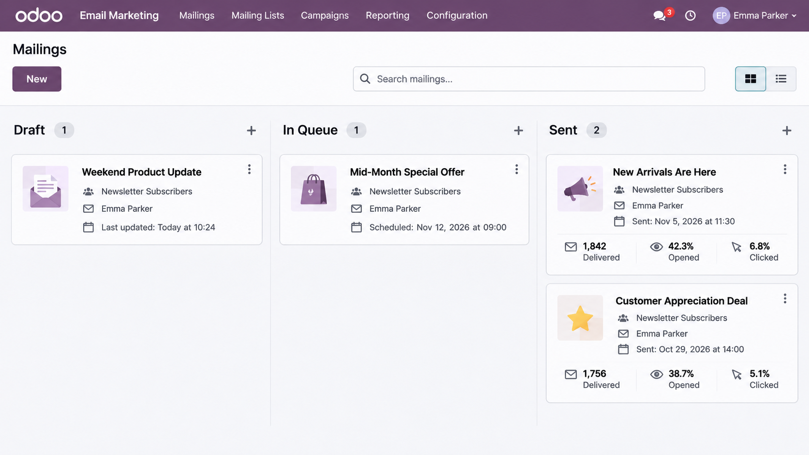
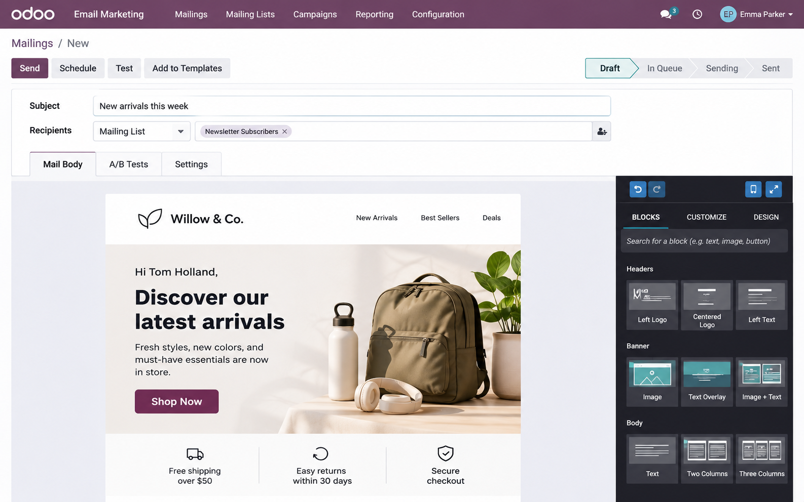
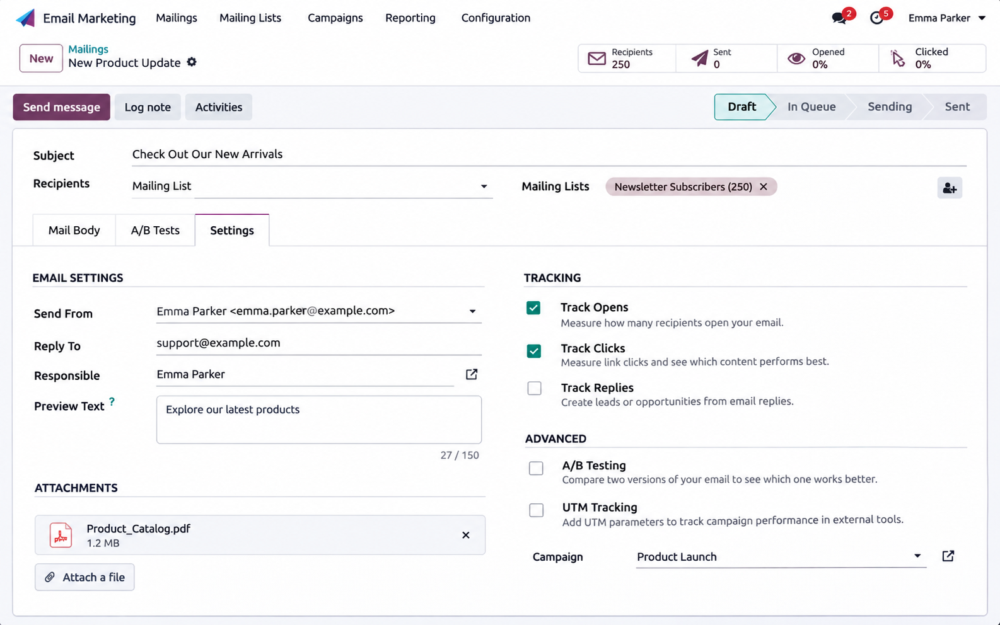
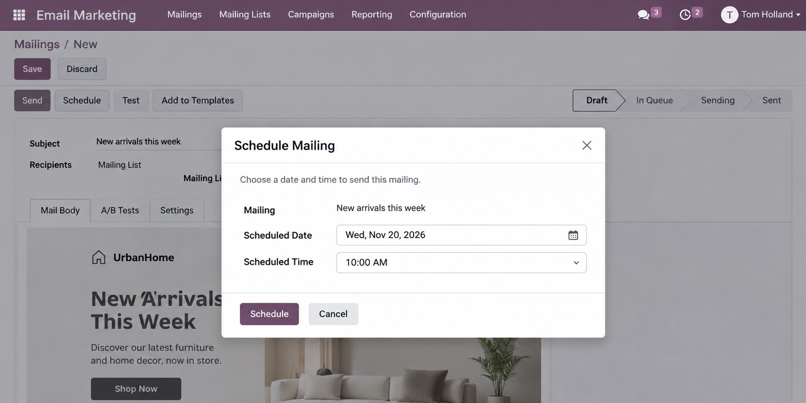
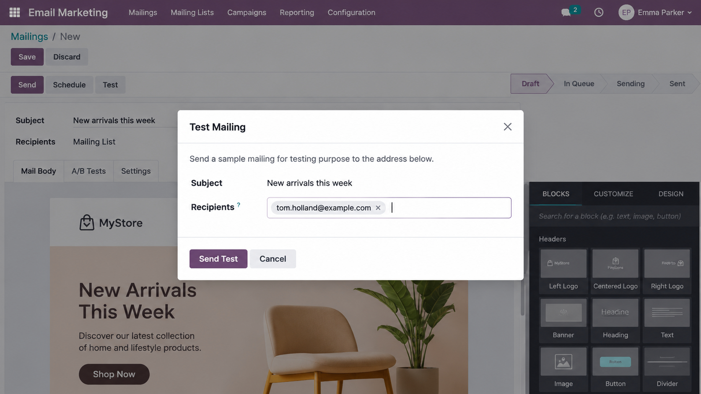

# Odoo Email Marketing: Create, Test, and Schedule a Mailing

Odoo Email Marketing lets users create, test, and schedule email campaigns from one place.

This guide covers the basic steps for creating a mailing, choosing the right recipients, editing the email, testing it, and deciding whether to send it now or schedule it for later.

> **Note:** This is an independent portfolio sample based on the Odoo Email Marketing workflow. The screenshots are recreated for demonstration purposes and do not show real customer data.

## 1. Create a New Mailing

Open **Email Marketing**, go to **Mailings**, and create a new mailing.

Start by adding:

1. A subject line
2. The type of recipients
3. The mailing list or contact group you want to target

Odoo also allows you to filter recipients when you only want the email to reach a specific group.

## 2. Choose and Edit the Email Layout

Open the **Mail Body** tab.

You can choose one of the available layouts or start with a blank template.

After choosing a layout, edit the content based on your campaign. You can change the text, images, buttons, and other content blocks by using the email editor.

Before moving on, check that the message is clear and that the main links or buttons are correct.

## 3. Review the Email Settings

Open the **Settings** tab before sending the mailing.

Here, you can review details such as:

- The sender
- The email address used in **Send From**
- The **Reply To** option
- The responsible user

The Reply To setting can be used to decide where replies should go, depending on the type of recipients selected.

## 4. Send a Test Email

Before sending the mailing to the full list, use the **Test** option.

You can send the test email to one or more test contacts.

1. Click **Test**.
2. Add the test recipient.
3. Send the test email.
4. Check the message before continuing.

Testing helps you check for problems before the email goes to the full audience.

## 5. Send or Schedule the Mailing

When the mailing is ready, you can either send it or schedule it.

### Send

Click **Send** if you want the mailing to be added to the sending queue.

### Schedule

Click **Schedule** if you want to choose a specific date and time.

The scheduled mailing will also be placed in the queue until it is ready to send.

## 6. Check the Mailing Status

After saving, sending, or scheduling the email, check its status in the mailing view.

A mailing may appear as:

- **Draft**
- **In Queue**
- **Sent**

This makes it easier to see which campaigns are still being edited and which ones are already waiting to be sent.

## Optional: Manage Email Campaigns

If you want to organize several marketing activities under one campaign, enable **Mailing Campaigns** under **Configuration > Settings**.

After enabling it, open **Campaigns** and create a campaign.

This can help keep related marketing activities and campaign information in one place.

## Notes

- Test the email before sending it to the full audience.
- Check the recipient group carefully before sending.
- Review the sender and Reply To settings when needed.
- Scheduled emails are placed in the queue until their sending time.
- Some options may look different depending on the Odoo version and configuration.

---

**Document type:** Product Documentation / User Guide  
**Platform:** Odoo Email Marketing  
**Audience:** Marketing and business users  
**Created by:** Erin Ma  
**Purpose:** Technical writing portfolio sample
