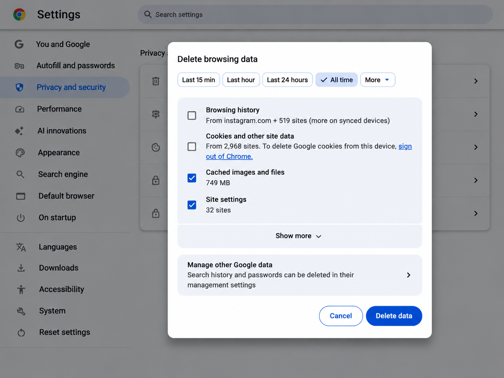
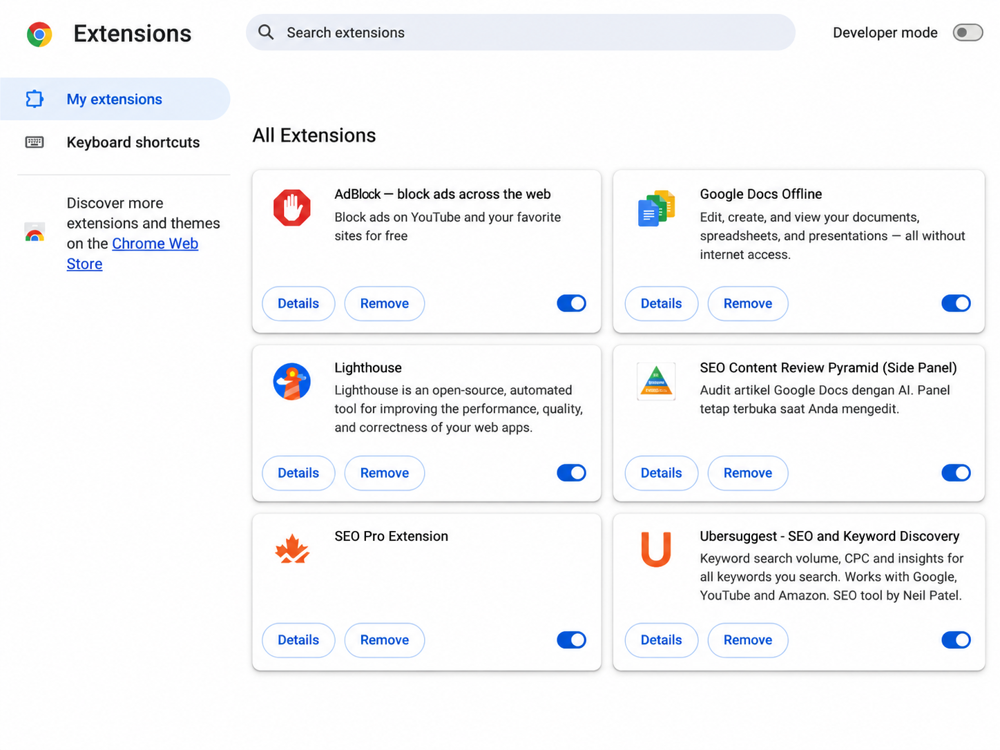
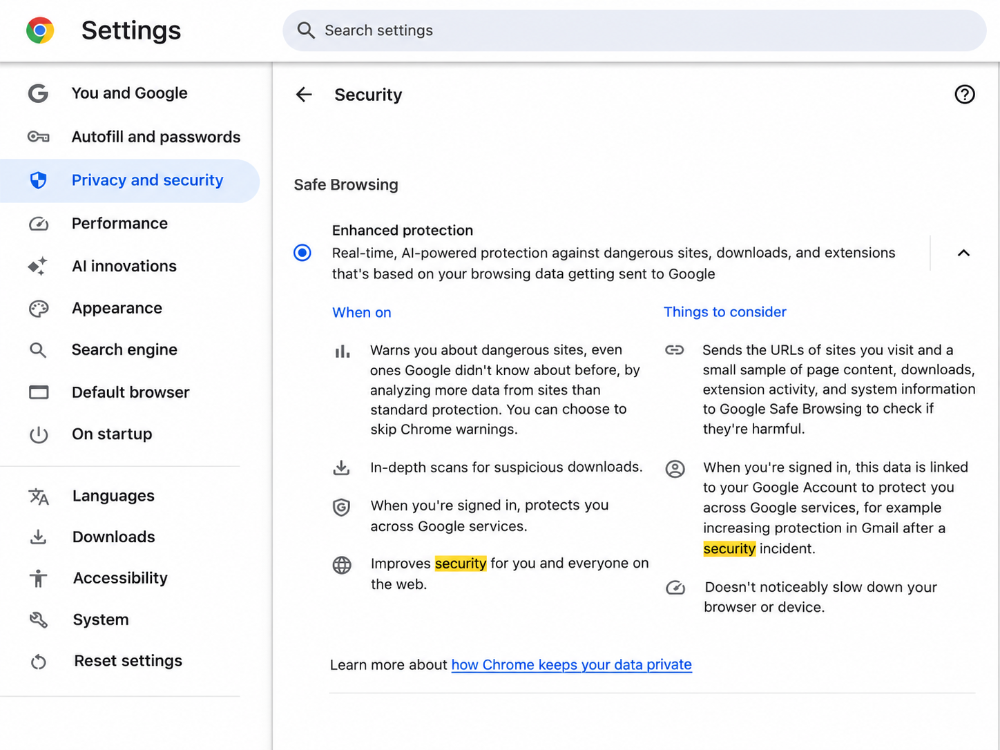

# Troubleshooting Guide: Website Not Loading Properly in Google Chrome

Sometimes a website does not load properly because of browser cache, extensions, or browser settings.

This guide covers a few simple steps you can try before contacting support.

## 1. Check Your Browser

First, make sure you are using Google Chrome and that the browser is working normally.

If the website requires a specific browser version, check that your Chrome version is supported.

## 2. Clear Cached Browser Data

Old cached files can sometimes cause a website to load incorrectly.

To clear the cache:

1. Open **Chrome Settings**.
2. Go to **Privacy and security**.
3. Select **Delete browsing data**.
4. Select **Cached images and files**.
5. Choose the time range you want to clear.
6. Click **Delete data**.
7. Reload the website.

After this, try opening the website again and check if the issue is resolved.

## 3. Try Incognito Mode

Incognito mode can help you check whether the issue is related to your normal browser settings or extensions.

1. Click the three-dot menu in the upper-right corner of Chrome.
2. Select **New Incognito Window**.
3. Open the website again.
4. Try the same task.

If the website works in Incognito mode, one of your extensions or browser settings may be causing the problem.

## 4. Check Browser Extensions

Some extensions can interfere with website functions.

To check your extensions:

1. Type `chrome://extensions/` in the address bar.
2. Review your installed extensions.
3. Turn off extensions one at a time.
4. Reload the website after each change.

You can start with extensions such as:

- Ad blockers
- Privacy tools
- Script blockers
- Other extensions that change how websites work

If the website starts working after you turn off an extension, that extension may be causing the issue.

## 5. Review Chrome Security Settings

Chrome security settings can also affect how some websites work.

1. Open **Chrome Settings**.
2. Go to **Privacy and security**.
3. Select **Security**.
4. Review your current Safe Browsing settings.

Do not disable security protection unless you understand the risk or the website's support team specifically asks you to change a setting.

## 6. Restart Chrome

After making any changes:

1. Close Chrome.
2. Open it again.
3. Return to the website.
4. Try the task again.

## 7. Reinstall Chrome if Needed

If the problem still happens, reinstalling Chrome may help.

Before reinstalling, make sure your important bookmarks or settings are saved or synced.

After reinstalling Chrome, open the website again and test the same task.

## If the Problem Still Happens

If none of the steps above work, contact the website's support team.

It may help to provide:

- Your Chrome version
- Your operating system
- A screenshot of the issue
- The exact error message, if there is one
- The steps you already tried

This information can help the support team understand the problem faster.

---

**Document type:** Troubleshooting Guide
**Platform:** Google Chrome
**Audience:** General users
**Created by:** Erin Ma
**Purpose:** Technical writing portfolio sample
